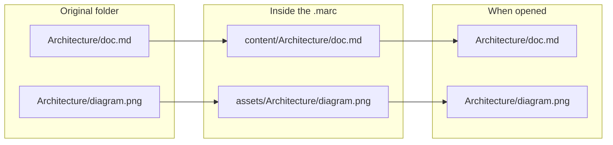

# The `.marc` format — specification

**Format version: `1.0.0`** · Status: stable · License: [CC BY 4.0](LICENSE-SPEC)

`.marc` is the portable file format of [MARC](README.md): a complete Markdown wiki (pages, images, attachments and a small manifest) in a single file. It is an **open format**: anyone can read, create and modify `.marc` files with their own tools, without MARC. Every MARC edition (EN, E and M) follows this same specification, so a `.marc` created in one opens in the others.

The key words **must**, **must not** and **should** are used as in RFC 2119. Field names in `manifest.json` are part of the format and are kept in Spanish (`version_formato`, `nombre_proyecto`…); they must not be translated.

## 1. A ZIP file

A `.marc` is a **standard ZIP archive** with a different extension.

- Rename `.marc` to `.zip` and any archive tool opens it; no special software is needed.
- Compression is **lossless**: no file changes and no image loses quality.
- Large files are supported (ZIP64).

## 2. Structure

```text
my-wiki.marc
├── manifest.json      the package manifest; always the FIRST entry of the ZIP
├── content/           the Markdown files (.md, .markdown)
└── assets/            everything else (images, PDF, data…)
```

Nothing else is allowed at the root.

### Mirrored trees

`content/` and `assets/` use **the same relative paths** as the original folder. When the package is opened, both trees are **overlaid** into a single folder, so the links inside your documents keep working **without rewriting the Markdown**: every `.md` is byte-for-byte identical to the original.



The same path must not exist in both trees.

## 3. `manifest.json`

A UTF-8 JSON object:

| Field | Type | Rule |
|---|---|---|
| `version_formato` | string (`"1.0.0"`) | Version of this specification. A reader accepts any `1.x.x` and rejects any other major version |
| `nombre_proyecto` | string, not empty | Name of the wiki |
| `tipo_origen` | `"git"` or `"local"` | Where the content came from |
| `repositorio_url` | string or `null` | Required with `git` (without user or password); `null` with `local` |
| `rama` | string or `null` | Branch. Required with `git`; `null` with `local` |
| `ultimo_commit` | string or `null` | Packaged commit (with `git`); `null` with `local` |
| `fecha_empaquetado` | string, ISO 8601 date in UTC (`2026-10-06T12:00:00Z`) | Updated every time the package is rewritten |

Example, **local** origin:

```json
{
  "version_formato": "1.0.0",
  "nombre_proyecto": "My wiki",
  "tipo_origen": "local",
  "repositorio_url": null,
  "rama": null,
  "ultimo_commit": null,
  "fecha_empaquetado": "2026-10-06T12:00:00Z"
}
```

Example, **git** origin:

```json
{
  "version_formato": "1.0.0",
  "nombre_proyecto": "MARC-DOC",
  "tipo_origen": "git",
  "repositorio_url": "https://github.com/Anton-Bazh/MARC-DOC.git",
  "rama": "main",
  "ultimo_commit": "4d7cabb…",
  "fecha_empaquetado": "2026-10-06T12:00:00Z"
}
```

> [!CAUTION]
> **Never credentials.** No field may contain tokens (`ghp_…`, `github_pat_…`), private keys (`-----BEGIN … PRIVATE KEY-----`) or `Bearer …` headers. A `.marc` that contains them **is not valid**: MARC refuses to create or open it. Tokens are kept separately, in each system's secure store.

## 4. Rules for writing a `.marc`

| Rule | Detail |
|---|---|
| Order | `manifest.json` must be the **first** entry of the ZIP |
| Markdown | `.md` and `.markdown` files go in `content/`; everything else in `assets/`, with the same relative path |
| Paths | Relative, with `/` as separator, without `..` or absolute paths |
| Always excluded | **Hidden** files and folders (starting with `.`: `.git`, `.obsidian`, `.env`…, which may hold credentials), **symbolic links** and **other `.marc` files** |
| Compression | DEFLATE for everything **except** already-compressed formats, which are stored without recompression (method *stored*) so their bytes stay identical: `png jpg jpeg gif webp avif heic jxl pdf zip gz xz bz2 7z zst mp4 mov webm mkv mp3 ogg opus m4a flac woff woff2 docx xlsx pptx odt ods odp` |

> [!NOTE]
> *Stored* compression is a recommendation. A reader must accept any standard ZIP method; storing the formats above only avoids spending time without saving space.

## 5. Rules for reading a `.marc`

A reader must **validate the whole package before extracting a single file**, and reject it if:

| Case | Why |
|---|---|
| `manifest.json` is missing, is not valid JSON, or its `version_formato` has another major version | The package cannot be interpreted |
| It contains credentials (§3) | Security |
| A path contains `..`, is absolute or starts with a drive (`C:`) | Prevents writing outside the destination folder (*zip slip*) |
| It contains symbolic links | They could point outside the package |
| There are entries outside `manifest.json`, `content/` and `assets/`, duplicate paths, or the same path in both trees | Invalid structure |
| More than **200 000** entries, more than **64 GiB** uncompressed, or an entry larger than 1 MiB that decompresses more than **200 times** its size | Protection against decompression bombs |

Recommendation: extract into a temporary folder and rename it at the end, so a half-written tree is never left behind.

## 6. Format versions

`version_formato` follows **major.minor.patch**:

- **Minor and patch:** compatible changes (new optional fields, clarifications). A `1.x` reader accepts them.
- **Major:** incompatible changes. A reader must reject, with a clear message, a package of another major version.

The format version is **independent** of the version of the MARC editions.

## 7. Using it

### Create a `.marc` with system tools (Linux)

From your wiki folder, with `zip` and `jq` installed:

```bash
SRC="$PWD"; OUT="$HOME/my-wiki.marc"; TMP=$(mktemp -d)
mkdir -p "$TMP/content" "$TMP/assets"
# Markdown to content/, everything else to assets/ (no hidden files, no symbolic links)
find . -type f ! -path '*/.*' ! -name '*.marc' | while read -r f; do
  case "$f" in *.md|*.markdown) d="content" ;; *) d="assets" ;; esac
  mkdir -p "$TMP/$d/$(dirname "$f")" && cp "$f" "$TMP/$d/$f"
done
jq -n --arg n "$(basename "$SRC")" --arg f "$(date -u +%Y-%m-%dT%H:%M:%SZ)" \
  '{version_formato:"1.0.0", nombre_proyecto:$n, tipo_origen:"local",
    repositorio_url:null, rama:null, ultimo_commit:null, fecha_empaquetado:$f}' > "$TMP/manifest.json"
cd "$TMP" && rm -f "$OUT" && zip -q -X "$OUT" manifest.json && zip -q -X -r "$OUT" content assets
rm -rf "$TMP"
```

Or use the reference implementation: `python3 reference/marc.py pack my-folder my-wiki.marc`.

### Read a `.marc` from a program (Python)

Standard library only:

```python
import json, zipfile

with zipfile.ZipFile("my-wiki.marc") as z:
    manifest = json.loads(z.read("manifest.json"))
    pages = [n for n in z.namelist() if n.startswith("content/") and not n.endswith("/")]
    print(manifest["nombre_proyecto"], "·", len(pages), "pages")
    home = z.read(pages[0]).decode("utf-8")
```

> [!WARNING]
> If you are going to **extract** a `.marc` you did not create, apply the checks of §5 first (the reference implementation does: `python3 reference/marc.py extract`). Reading the content in memory, as above, is safe; writing it to disk without validating the paths is not.

## 8. Behaviour of the MARC applications (informative)

This section describes how MARC uses the format; it adds no rules.

| Behaviour | Detail |
|---|---|
| Editing | In MARC E and M every `.marc` is editable: each save rewrites the package (with an updated `fecha_empaquetado`), atomically |
| Linking (`git` origin) | A `.marc` with `tipo_origen: "git"` can be **linked** with its repository: MARC clones it, places it at `ultimo_commit`, keeps what was edited inside the `.marc` as a draft and then brings in newer commits. After publishing or updating, the package is rewritten with the new `ultimo_commit` |
| History | Git history is **not** stored inside the package (it would include other people's e-mail addresses and grow large); it comes from the link |
| MARC EN | The lightweight edition opens `git`-origin packages as read-only |

## Changes

| Version | Date | Change |
|---|---|---|
| 1.0.0 | 2026-10-06 | First stable version |
